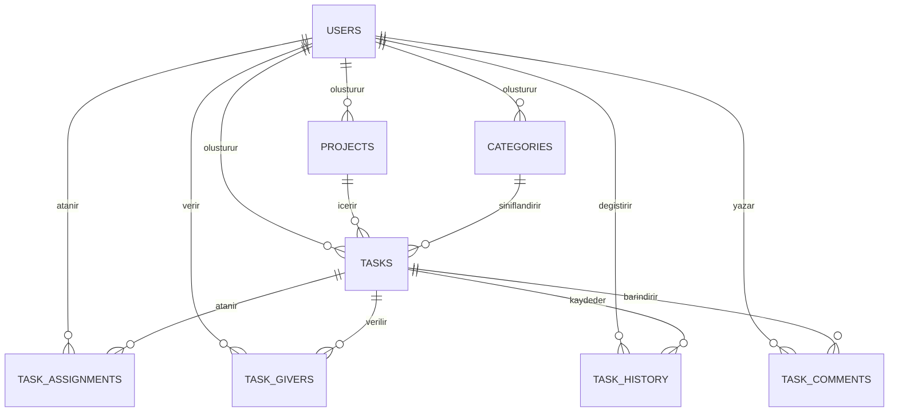

# ToDo+ Görev Takip Sistemi

ToDo+, rol tabanlı bir ekip çalışma alanı olarak tasarlanmış; üyelik, yönetici/çalışan ayrımı, görev atama, önceliklendirme, Kanban takibi, yorum, geçmiş kaydı, filtreleme ve istatistik özelliklerini bir araya getiren bir web uygulamasıdır. Proje hem demo hem de Supabase çalışma modunu destekler.

Bu dosya projenin kullanım kılavuzu, teknik raporu, veritabanı dokümantasyonu, Supabase kurulum rehberi, test planı ve teslim kontrol listesidir.

## 1. Projenin Amacı

Uygulamanın amacı yalnızca yapılacaklar listesi oluşturmak değil; görevlerin proje, kategori, kullanıcı, rol, öncelik, süre, durum ve teslim tarihi bilgileriyle izlenebildiği genişletilebilir bir görev yönetim sistemi sunmaktır.

Temel hedefler:

- Proje, kategori ve görev CRUD işlemlerini gerçekleştirmek.
- Görevleri kullanıcılarla ve görevi veren kişilerle ilişkilendirmek.
- Görev durumlarını liste ve Kanban görünümünde takip etmek.
- Görev geçmişini ve yorumlarını saklamak.
- Öncelik ağırlıklı başarı oranı hesaplamak.
- Demo moduyla kurulumsuz çalışmak.
- Supabase/PostgreSQL altyapısına bağlanabilmek.
- Masaüstü ve mobil ekranlarda kullanılabilir bir arayüz sunmak.

## 2. Kullanılan Teknolojiler

- HTML5
- CSS3
- Vanilla JavaScript
- LocalStorage
- Supabase Authentication
- Supabase/PostgreSQL
- Row Level Security (RLS)
- Playwright
- Draw.io / diagrams.net
- Mermaid

## 3. Özellikler

### Kullanıcı ve oturum

- Demo giriş ve kayıt
- Supabase Authentication desteği
- Oturumdan çıkış
- Rol bazlı üyelik sistemi
- Yönetici ve çalışan ayrımı
- Yönetici tarafından kullanıcı ekleme
- Demo verilerini başlangıç durumuna döndürme
- Bağlantı ve senkronizasyon durumu göstergesi

### Proje ve kategori yönetimi

- Proje oluşturma, listeleme, düzenleme ve silme
- Proje ilerleme yüzdesi
- Kategori oluşturma, düzenleme ve silme
- Kategori rengi belirleme
- Görevlere kategori atama

### Görev yönetimi

- Görev oluşturma, listeleme, düzenleme ve silme
- Proje ve kategori seçimi
- Atanan kullanıcı seçimi
- Bir veya birden fazla görevi veren kullanıcı seçimi
- Yönetici için ekip ve rol görünümü
- Ayrı yönetici paneli: ekip özeti, proje/kategori yönetimi, görev oluşturma, atama ve performans takibi
- Yönetici karar desteği: aktif iş yükü, geciken görev, tahmini dakika ve başarı oranına göre görev atama önerisi
- Çoklu yönetici desteği ve ekip listesinden güvenli rol değiştirme
- Ayrı kullanıcı paneli: yalnızca kişiye atanmış görevler, kişisel istatistikler, durum güncelleme ve yorum
- Arayüz ve işlem seviyesinde rol tabanlı yetki kontrolü
- Düşük, orta ve yüksek öncelik
- Bekliyor, devam ediyor ve tamamlandı durumları
- Tahmini süre ve son teslim tarihi
- Görev detayı modalı
- Görev yorumları
- Görev durum geçmişi
- Görevi tamamlama veya tekrar açma
- Kanban üzerinde sürükle-bırak durum değiştirme

### Arama ve raporlama

- Başlık, açıklama ve proje adına göre arama
- Durum, öncelik, kategori ve atanan kullanıcı filtresi
- Teslim tarihi, öncelik veya oluşturulma tarihine göre sıralama
- Filtreleri tek işlemle temizleme
- Toplam, tamamlanan, devam eden ve geciken görev sayısı
- Yaklaşan teslim tarihleri
- Kullanıcı bazlı başarı oranı ve ekip analizi
- Proje ilerleme çubuğu
- Son görev hareketleri

### Kullanılabilirlik

- Mobil açılır menü
- Klavye odak göstergeleri
- İşlem başarı ve hata bildirimleri
- Geciken ve yaklaşan görev rozetleri
- Erişilebilir modal ve durum mesajları
- Azaltılmış hareket tercihi desteği

## 4. Proje Yapısı

```text
todo app uygulaması/
├── index.html
├── styles.css
├── app.js
├── supabase-config.js
├── supabase-schema.sql
├── package.json
├── README.md
├── screenshots/
│   ├── 01-giris-ekrani.png
│   ├── 02-istatistik-ekrani.png
│   ├── 03-projeler-kategoriler.png
│   ├── 04-gorevler-ekrani.png
│   ├── 05-gorev-detayi-yorumlar.png
│   ├── 06-kanban-panosu.png
│   ├── 07-gorev-cekmece-formu.png
│   ├── 08-mobil-genel-bakis.png
│   └── 09-mobil-yan-menu.png
├── scripts/
│   ├── capture-screenshots.mjs
│   └── smoke-test.mjs
└── todo-plus/
    ├── todo-plus-er-diyagram.drawio
    └── veritabani-diyagramlari.html
```

Ana dosyalar:

- `index.html`: Sayfa yapısı, formlar, görünümler ve modal.
- `styles.css`: Tema, responsive düzen, Kanban, kartlar ve bildirimler.
- `app.js`: State, authentication, CRUD, render, filtre ve senkronizasyon işlemleri.
- `supabase-config.js`: Supabase bağlantı bilgileri.
- `supabase-schema.sql`: Tablolar, ilişkiler, indeksler, view, fonksiyon ve RLS politikaları.
- `package.json`: Test ve ekran görüntüsü komutları.
- `scripts/smoke-test.mjs`: Temel kullanıcı akışlarının otomatik testi.
- `scripts/capture-screenshots.mjs`: Teslim ekran görüntülerinin oluşturulması.

## 5. Hızlı Başlangıç

### Gereksinimler

- Güncel bir web tarayıcısı
- Yerel sunucu için Python veya VS Code Live Server
- Otomatik test için Node.js ve npm

### Demo modunu çalıştırma

Proje klasöründe:

```powershell
python -m http.server 4173 --bind 127.0.0.1
```

Tarayıcı adresi:

```text
http://127.0.0.1:4173/
```

Demo hesabı:

```text
E-posta: omer@example.com
Şifre: 123456
```

Demo modunda veriler tarayıcının LocalStorage alanında saklanır. Supabase bilgileri boş bırakıldığında uygulama otomatik olarak bu modda çalışır.

## 6. Çalışma Modları

### Demo modu

- Kurulum gerektirmez.
- Demo authentication kullanır.
- Verileri LocalStorage içinde saklar.
- Yönetici rolü demo veride yerleşik gelir.
- Yönetici kullanıcı ekleyebilir, normal kullanıcı ekleme yapamaz.

### Supabase modu

- Gerçek kullanıcı giriş ve kayıt akışını kullanır.
- Verileri PostgreSQL tablolarında saklar.
- RLS politikalarıyla görev ilişkilerine göre erişim uygular.
- Yerel değişiklikleri kontrollü biçimde Supabase'e senkronize eder.
- `users.role` alanı ile yönetici/çalışan ayrımı saklanır.
- Bağlantı durumu arayüzün üst bölümünde gösterilir.

> Üretim kullanımında demo kullanıcı ekleme ve demo sıfırlama işlemleri Supabase modunda kapatılmalı veya gerçek davet/yönetim akışına dönüştürülmelidir.

## 7. Supabase Kurulumu

1. [Supabase](https://supabase.com) üzerinde yeni bir proje oluşturun.
2. SQL Editor ekranını açın.
3. `supabase-schema.sql` dosyasının tamamını çalıştırın.
4. Project Settings → API bölümünden Project URL ve anon/public key değerlerini alın.
5. `supabase-config.js` dosyasını doldurun:

```js
window.TODO_PLUS_SUPABASE = {
  url: "https://PROJE_ID.supabase.co",
  anonKey: "SUPABASE_ANON_KEY",
};
```

6. Authentication → Providers → Email sağlayıcısının etkin olduğunu doğrulayın.
7. E-posta doğrulaması kullanılacaksa Site URL ve Redirect URL ayarlarını yerel veya canlı uygulama adresine göre yapılandırın.
8. Uygulamayı yerel sunucu üzerinden açıp yeni bir kullanıcı kaydıyla test edin.
9. İlk yönetici hesabı kayıt olduktan sonra SQL Editor içinde yalnızca bir kez aşağıdaki komutu çalıştırın:

```sql
update public.users
set role = 'admin'
where email = 'yonetici@ornek.com';
```

Sonraki rol değişiklikleri yönetici yetkisiyle yapılmalıdır. Normal kullanıcı kendi `role` değerini değiştiremez.

Güvenlik notları:

- `anonKey` istemci tarafında kullanılabilir; `service_role` anahtarı kesinlikle tarayıcı koduna yazılmamalıdır.
- RLS kapatılmamalıdır.
- Yönetici olmayan kullanıcı proje, kategori, görev ataması veya görev yönetim alanlarını değiştiremez.
- Çalışan yalnızca kendisine atanan görevin durumunu, tamamlanma kaydını ve kendi yorumlarını güncelleyebilir.
- Gerçek projede kullanıcı e-posta görünürlüğü ve profil erişimi ihtiyaç kadar sınırlandırılmalıdır.
- Supabase modu gerçek proje bilgileriyle ayrıca uçtan uca test edilmelidir.

## 8. Veritabanı Tasarımı

### Tablolar

| Tablo | Amaç |
|---|---|
| `users` | Supabase Auth kullanıcısına bağlı profil bilgileri |
| `projects` | Kullanıcıların oluşturduğu projeler |
| `categories` | Görevleri sınıflandıran renkli kategoriler |
| `tasks` | Görevlerin temel bilgileri |
| `task_assignments` | Görev-kullanıcı atamaları ve kazanılan puan |
| `task_givers` | Görevi veren kullanıcılar |
| `task_history` | Görev durum değişiklikleri |
| `task_comments` | Görev yorumları |

### ER diyagramı



### Temel veri kuralları

- Her proje bir kullanıcıya bağlıdır.
- Her görev bir projeye ve oluşturan kullanıcıya bağlıdır.
- Kategori isteğe bağlıdır; kategori silinirse görev kategorisiz kalabilir.
- Öncelik yalnızca `dusuk`, `orta`, `yuksek` olabilir.
- Durum yalnızca `bekliyor`, `devam_ediyor`, `tamamlandi` olabilir.
- Aynı görev-kullanıcı ataması tekrar edemez.
- Aynı kullanıcı aynı görev için birden fazla “veren” kaydı alamaz.
- Proje veya görev silindiğinde ilgili alt kayıtlar foreign-key kurallarına göre temizlenir.

Draw.io üzerinde düzenlenebilir ayrıntılı diyagram `todo-plus/todo-plus-er-diyagram.drawio` dosyasındadır.

## 9. Başarı Oranı

Başarı hesabı tamamlanan görev sayısına değil, görev önceliklerinin ağırlığına göre yapılır.

| Öncelik | Puan |
|---|---:|
| Düşük | 1 |
| Orta | 2 |
| Yüksek | 3 |

```text
başarı_oranı = tamamlanan_görevlerin_puanı / atanmış_tüm_görevlerin_puanı × 100
```

Örnek: yüksek, orta ve düşük öncelikli üç görevin toplam değeri 6 puandır. Kullanıcı yüksek ve düşük öncelikli görevleri tamamlarsa 4 puan kazanır ve başarı oranı yaklaşık `%66,7` olur.

## 10. Otomatik Test

Bağımlılıkları kurun:

```powershell
npm install
```

Uygulamayı çalıştırın:

```powershell
python -m http.server 4173 --bind 127.0.0.1
```

Başka bir terminalde:

```powershell
npm test
```

Smoke test şu akışları doğrular:

1. Demo hesabıyla giriş
2. Proje oluşturma
3. Kategori oluşturma
4. Görev oluşturma
5. Arama ve filtreleri temizleme
6. Görev detayını açma ve yorum ekleme
7. Görev durumunu tamamlama
8. Mobil menüyü açma

Ekran görüntülerini yeniden üretmek için:

```powershell
npm run screenshots
```

> Test scriptleri teslim ortamında yalnızca proje bağımlılıklarındaki `playwright` paketini kullanacak şekilde taşınabilir tutulmalıdır. Makineye özel mutlak yollar kullanılmamalıdır.

## 11. Manuel Test Planı

### Authentication

- Doğru demo bilgileriyle giriş yapılabilmeli.
- Hatalı parola kullanıcıya açıklanmalı.
- Yeni demo kullanıcı kaydı oluşturulabilmeli.
- Çıkış sonrası giriş ekranı görünmeli.

### Proje ve kategori

- Proje ve kategori oluşturma, düzenleme ve silme çalışmalı.
- Proje silinirken bağlı görevler için onay istenmeli.
- Kategori silinince görevler kategorisiz kalmalı.
- Proje ilerleme oranı görev durumlarına göre güncellenmeli.

### Görev

- Tüm alanlarla görev oluşturulabilmeli.
- Görev düzenleme mevcut bilgileri forma getirmeli.
- Durum değişimi listeyi, Kanban'ı ve istatistikleri güncellemeli.
- Sürükle-bırak sonrası görev doğru kolonda görünmeli.
- Silme öncesi kullanıcı onayı alınmalı.
- Detay modalı, geçmiş ve yorumlar doğru göreve ait olmalı.

### Filtre ve istatistik

- Arama, durum, öncelik, kategori ve kullanıcı filtreleri birlikte çalışmalı.
- Filtre temizleme başlangıç değerlerini geri getirmeli.
- Geciken tamamlanmamış görevler doğru hesaplanmalı.
- Başarı oranı öncelik katsayılarına göre değişmeli.
- Yaklaşan teslimler tarih sırasıyla gösterilmeli.

### Responsive ve erişilebilirlik

- 390 px genişlikte mobil menü açılıp kapanmalı.
- Tab tuşuyla tüm kontroller erişilebilir olmalı.
- Escape tuşu görev detay modalını kapatmalı.
- Bildirimler ekran okuyucu canlı bölgesinde duyurulmalı.

### Supabase

- Kayıt, giriş, çıkış ve oturum yenileme test edilmeli.
- Proje, kategori, görev, atama, veren, geçmiş ve yorum kayıtları doğrulanmalı.
- RLS ile ilgisiz kullanıcıların verilere erişemediği kontrol edilmeli.
- Ağ kesintisinde yerel verinin korunması ve hata mesajı doğrulanmalı.
- Silme ve yeniden senkronizasyon sonrasında kayıtların geri gelmediği kontrol edilmeli.

## 12. Teslim Kontrol Listesi

- [x] HTML, CSS ve JavaScript uygulaması hazırlandı.
- [x] Responsive masaüstü ve mobil arayüz hazırlandı.
- [x] Demo authentication ve LocalStorage modu hazırlandı.
- [x] Proje, kategori ve görev CRUD işlemleri hazırlandı.
- [x] Kanban, filtreleme, sıralama ve sürükle-bırak hazırlandı.
- [x] Görev detayı, yorum ve geçmiş akışı hazırlandı.
- [x] Başarı oranı ve istatistikler hazırlandı.
- [x] Supabase SQL şeması ve RLS politikaları hazırlandı.
- [x] ER ve Draw.io diyagramları hazırlandı.
- [x] Otomatik smoke test hazırlandı ve demo akışında çalıştırıldı.
- [x] JavaScript sözdizimi ve Git diff kontrolleri çalıştırıldı.
- [x] Teslim ekran görüntüleri oluşturuldu.
- [x] Proje dokümantasyonu tek dosyada birleştirildi.
- [ ] Gerçek Supabase proje bilgileriyle uçtan uca test yapılmalı.
- [ ] Test ve ekran görüntüsü scriptlerindeki makineye özel yollar kaldırılmalı.
- [ ] Supabase modunda demo kullanıcı ekleme ve sıfırlama işlemleri kapatılmalı.
- [x] Rol yükseltme ve görev yönetim alanları veritabanı tetikleyicileriyle korunuyor.
- [ ] Supabase profil/e-posta görünürlüğü ekip üyeliği tablosuyla daha dar bir politikaya bağlanmalı.
- [ ] Senkronizasyon kuyruğu eşzamanlı yazımlara karşı güçlendirilmeli.

## 13. Bilinen Sınırlar

- Proje şu anda ağırlıklı olarak demo modunda doğrulanmıştır.
- Supabase entegrasyonu için gerçek proje URL'si ve anon key gereklidir.
- Çok kullanıcılı proje üyeliği ve rol modeli henüz ayrı tablolarla uygulanmamıştır.
- Demo kullanıcı ekleme gerçek Supabase Auth hesabı oluşturmaz.
- Dosya ekleri, alt görevler, tekrar eden görevler ve bildirim sistemi bulunmaz.
- `app.js` büyüktür; sonraki sürümde modüllere ayrılması önerilir.

## 14. Geliştirme Yol Haritası

### Öncelikli

1. Supabase modu için kullanıcı daveti, proje üyeliği ve rol modeli.
2. Senkronizasyon ve silme işlemlerinin satır bazlı güvenilir hâle getirilmesi.
3. Test scriptlerinin tamamen taşınabilir hâle getirilmesi.
4. Gerçek Supabase ortamında RLS entegrasyon testleri.
5. `app.js` dosyasının auth, state, render, tasks, projects ve database modüllerine ayrılması.

### Sonraki sürümler

- Alt görevler ve görev bağımlılıkları
- Dosya ekleri ve Supabase Storage
- Gerçek zamanlı güncellemeler
- Yorum düzenleme ve silme
- Proje üyeleri ve roller
- Haftalık/aylık raporlar
- Grafikler ve zaman çizelgesi
- Tekrarlayan görevler
- Arşivleme ve gelişmiş bildirimler

## 15. Kısa Sunum Metni

ToDo+, kullanıcıların proje oluşturabildiği, görevleri kategorilere ayırabildiği, kişilere atayabildiği ve Kanban panosunda takip edebildiği bir görev yönetim uygulamasıdır. Görevlerin öncelik, durum, süre ve teslim tarihi bilgileri saklanır; yorum ve geçmiş kayıtları görev detayında görüntülenir. Kullanıcı başarısı, tamamlanan görevlerin öncelik puanları üzerinden hesaplanır. Uygulama kurulum gerektirmeyen demo moduyla çalışabildiği gibi Supabase Authentication ve PostgreSQL altyapısına bağlanacak şekilde de hazırlanmıştır.

## 16. Lisans ve Kullanım

Bu proje eğitim, portföy ve proje teslimi amacıyla hazırlanmıştır. Gerçek kullanıcı verileriyle canlıya alınmadan önce güvenlik politikaları, Supabase entegrasyon testleri, gizlilik gereksinimleri ve hata izleme altyapısı ayrıca değerlendirilmelidir.
