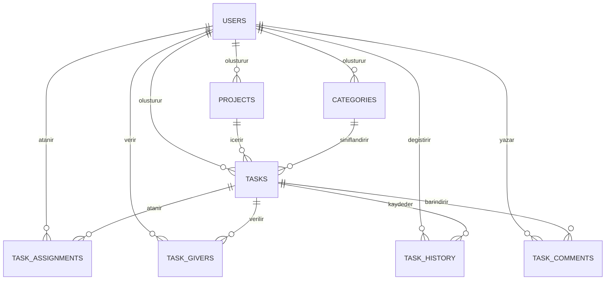

<p align="center"></p>

# Docket: görev takip sistemi

> Proje önceki sürümlerde ToDo+ adıyla geliştirildi. Tarayıcıdaki kayıt anahtarlarını (`todo_plus_*`) ve kod içindeki global adları (`window.TODO_PLUS_*`) eski haliyle bıraktım; böylece mevcut veriler ve yayın ayarları bozulmuyor.

Docket, ekipler için rol tabanlı bir web uygulaması. Üyelik, yönetici/çalışan ayrımı, görev atama, önceliklendirme, Kanban takibi, yorum, geçmiş kaydı, filtreleme ve istatistik özelliklerini içeriyor. Demo modunda ve Supabase modunda çalışabiliyor.

Bu dosya aynı zamanda projenin kullanım kılavuzu, teknik raporu, veritabanı dokümantasyonu, Supabase kurulum rehberi, test planı ve teslim kontrol listesi.

## 1. Projenin amacı

Docket'i basit bir yapılacaklar listesinden daha fazlası olsun diye yaptım. Görevler proje, kategori, kullanıcı, rol, öncelik, süre, durum ve teslim tarihiyle birlikte izlenebiliyor, sistem de sonradan genişletilebilecek şekilde kurulu.

Hedeflerim şunlardı:

- Proje, kategori ve görev CRUD işlemlerini yapmak.
- Görevleri kullanıcılara ve görevi veren kişilere bağlamak.
- Görev durumlarını liste ve Kanban görünümünde izlemek.
- Görev geçmişini ve yorumlarını saklamak.
- Öncelik ağırlıklı başarı oranı hesaplamak.
- Demo moduyla kurulum yapmadan çalışabilmek.
- Supabase/PostgreSQL altyapısına bağlanabilmek.
- Masaüstü ve mobil ekranlarda kullanılabilir bir arayüz sunmak.

## 2. Kullanılan teknolojiler

- HTML5
- CSS3
- Vanilla JavaScript
- LocalStorage
- Supabase Authentication
- Supabase/PostgreSQL
- Row Level Security (RLS)
- Playwright
- Draw.io / diagrams.net
- Mermaid

## 3. Özellikler

### Kullanıcı ve oturum

- Demo giriş ve kayıt
- Supabase Authentication desteği
- Oturumdan çıkış
- Rol bazlı üyelik sistemi
- Yönetici ve çalışan ayrımı
- Yönetici tarafından kullanıcı ekleme
- Demo verilerini başlangıç durumuna döndürme
- Bağlantı ve senkronizasyon durumu göstergesi

### Proje ve kategori yönetimi

- Proje oluşturma, listeleme, düzenleme ve silme
- Proje ilerleme yüzdesi
- Kategori oluşturma, düzenleme ve silme
- Kategori rengi belirleme
- Görevlere kategori atama

### Görev yönetimi

- Görev oluşturma, listeleme, düzenleme ve silme
- Proje ve kategori seçimi
- Atanan kullanıcı seçimi
- Bir veya birden fazla görevi veren kullanıcı seçimi
- Yönetici için ekip ve rol görünümü
- Ayrı yönetici paneli: ekip özeti, proje/kategori yönetimi, görev oluşturma, atama ve performans takibi
- Çoklu yönetici desteği ve ekip listesinden güvenli rol değiştirme
- Ayrı kullanıcı paneli: yalnızca kişiye atanmış görevler, kişisel istatistikler, durum güncelleme ve yorum
- Arayüz ve işlem seviyesinde rol tabanlı yetki kontrolü
- Düşük, orta ve yüksek öncelik
- Yapılacak ve tamamlandı durumları
- Tahmini süre ve son teslim tarihi
- Görev detayı modalı
- Görev yorumları
- Görev durum geçmişi
- Görevi tamamlama veya tekrar açma
- Görev, proje ve kategori silme sonrası 8 saniyelik "Geri al" (bulut silmesi bu süre dolana kadar bekletilir)
- Tekrarlayan görevlerde bir sonraki örnek, görev kimliği ve tarihten türetilen sabit bir kimlikle oluşur. Aynı görev iki cihazda tamamlansa da çift kayıt oluşmaz.
- Yönetici tarafından açılan hesaplar ilk girişte şifre değiştirmeye yönlendirilir
- Kanban üzerinde sürükle-bırak durum değiştirme
- Tarihe göre gruplanmış kompakt görev listesi (Gecikmiş / Bugün / Önümüzdeki 7 gün / Daha sonra / Tarihsiz). Yuvarlak kutu görevi tamamlar, başlık detayı açar.
- Kanban sütunlarını duruma, önceliğe, kişiye veya projeye göre gruplama
- Takvimde Ay / Hafta görünümü

### Arama ve raporlama

- Başlık, açıklama ve proje adına göre arama
- Durum, öncelik, kategori ve atanan kullanıcı filtresi
- Teslim tarihi, öncelik veya oluşturulma tarihine göre sıralama
- Filtreleri tek işlemle temizleme
- Toplam, tamamlanan ve geciken görev sayısı
- Yaklaşan teslim tarihleri
- Kullanıcı bazlı başarı oranı ve ekip analizi
- Proje ilerleme çubuğu
- Son görev hareketleri

### Kullanılabilirlik

- Mobil açılır menü
- Mobilde alt gezinme çubuğu (Bugün, Görevler, Takvim, Özet, Menü)
- Tarayıcı `confirm()` yerine temaya uyan uygulama içi onay penceresi
- Q kısayoluyla hızlı ekleme alanına odaklanma
- Klavye odak göstergeleri
- İşlem başarı ve hata bildirimleri
- Geciken ve yaklaşan görev rozetleri
- Erişilebilir modal ve durum mesajları
- Azaltılmış hareket tercihi desteği
- Koyu tema (Aydınlık / Koyu / Sistem). Üst çubuktaki ay/güneş simgesinden değiştirilir ve tercih cihazda saklanır. Renklerin WCAG AA (4.5:1) kontrastını sağladığını ayrıca test ettim.

## 4. Proje yapısı

```text
docket/
├── index.html
├── styles.css
├── app.js                      # ana uygulama (auth, render, olaylar)
├── app-*.js                    # ayrılmış modüller: utils, storage, task-model, sync-merge,
│                               #   quick-add-parser, supabase, supabase-mapper, document-assistant, config
├── supabase-config.js
├── supabase-schema.sql
├── package.json
├── README.md
├── server/                     # Express API: doküman asistanı (RAG) ve yönetici kullanıcı oluşturma
├── tests/                      # birim testleri (sync-merge, utils-and-parser)
├── icons/                      # logo.svg (kaynak logo) ve ondan üretilen PWA simgeleri
├── vendor/supabase.js          # çevrimdışı açılış için yerel supabase-js kopyası
├── .github/workflows/ci.yml    # GitHub Actions: sunucu/birim testleri + tarayıcı testleri
├── screenshots/
│   ├── 01-giris-ekrani.png
│   ├── 02-istatistik-ekrani.png
│   ├── 03-projeler-kategoriler.png
│   ├── 04-gorevler-ekrani.png
│   ├── 05-gorev-detayi-yorumlar.png
│   ├── 06-kanban-panosu.png
│   ├── 07-gorev-cekmece-formu.png
│   ├── 08-mobil-genel-bakis.png
│   └── 09-mobil-yan-menu.png
├── scripts/
│   ├── capture-screenshots.mjs
│   └── smoke-test.mjs
└── docket/
    ├── docket-er-diyagram.drawio
    └── veritabani-diyagramlari.html
```

Ana dosyalar:

- `index.html`: sayfa yapısı, formlar, görünümler ve modal.
- `styles.css`: tema, responsive düzen, Kanban, kartlar ve bildirimler.
- `app.js`: state, authentication, CRUD, render, filtre ve senkronizasyon işlemleri.
- `supabase-config.js`: Supabase bağlantı bilgileri.
- `supabase-schema.sql`: tablolar, ilişkiler, indeksler, view, fonksiyon ve RLS politikaları.
- `package.json`: test ve ekran görüntüsü komutları.
- `scripts/smoke-test.mjs`: temel kullanıcı akışlarının otomatik testi.
- `scripts/capture-screenshots.mjs`: teslim ekran görüntülerini oluşturur.

## 5. Hızlı başlangıç

### Gereksinimler

- Güncel bir web tarayıcısı
- Yerel sunucu için Python veya VS Code Live Server
- Otomatik test için Node.js ve npm

### Demo modunu çalıştırma

Proje klasöründe şu komutu çalıştırın:

```powershell
python -m http.server 4173 --bind 127.0.0.1
```

Sonra tarayıcıda şu adresi açın:

```text
http://127.0.0.1:4173/
```

Demo hesabı:

```text
E-posta: omer@example.com
Şifre: 123456
```

Demo modunda veriler tarayıcının LocalStorage alanında tutulur. Supabase bilgileri boş bırakılırsa uygulama kendiliğinden bu modda açılır.

## 6. Çalışma modları

### Demo modu

- Kurulum gerektirmez.
- Demo authentication kullanır.
- Verileri LocalStorage içinde saklar.
- Yönetici rolü demo veride hazır gelir.
- Yönetici kullanıcı ekleyebilir, normal kullanıcı ekleyemez.

### Supabase modu

- Gerçek kullanıcı giriş ve kayıt akışını kullanır.
- Verileri PostgreSQL tablolarında saklar.
- RLS politikalarıyla görev ilişkilerine göre erişimi sınırlar.
- Yerel değişiklikleri kontrollü biçimde Supabase'e senkronize eder.
- Yönetici/çalışan ayrımı `users.role` alanında tutulur.
- Bağlantı durumu arayüzün üst bölümünde görünür.

> Üretimde demo kullanıcı ekleme ve demo sıfırlama işlemleri Supabase modunda kapatılmalı ya da gerçek bir davet/yönetim akışıyla değiştirilmeli.

### Yayına alma ve PWA

Uygulama bir PWA (`manifest.webmanifest`, `sw.js`). İlk ziyaretten sonra kabuk dosyaları önbelleğe alınır; ağ kesikken sayfa yenilense bile açılır ve ana ekrana eklenebilir. Strateji "önce ağ, olmazsa önbellek" olduğu için çevrimiçiyken her zaman güncel kod gelir. Ücretsiz yayın adımları (GitHub Pages + Render) `DEPLOY.md` dosyasında.

### Çevrimdışı çalışma (Supabase modu)

Uygulama yerel öncelikli çalışır. Her değişiklik önce cihaza (LocalStorage) yazılır, sonra buluta gönderilir.

Çevrimdışıyken şunlar çalışır:

- İnternet yokken görev ve proje ekleme, düzenleme, tamamlama ve silme yapılabilir. Hepsi cihazda saklanır.
- Sayfa çevrimdışıyken yenilense bile uygulama Supabase modunda açılır (kütüphane `vendor/` içinden yüklenir) ve son veriler görünür.
- Durum rozeti son başarılı eşitleme saatini gösterir ("Çevrimdışı · Son eşitleme 14:03" gibi). İlk çevrimdışı değişiklikte kısa bir bilgi notu çıkar.
- Bağlantı gelince bekleyen değişiklikler kendiliğinden gönderilir. Bulut verisi yerelin üzerine yazılmaz; taban, yerel ve bulut sürümleri alan bazlı birleştirilir (`app-sync-merge.js`). Bir alanı yalnızca bir taraf değiştirdiyse o taraf kazanır, çevrimdışı oluşturulan kayıtlar korunur, yorum ve geçmiş listeleri birleşir.
- İki taraf aynı alanı farklı değiştirdiyse "Hangisi kalsın?" kartı açılır. İki sürüm yan yana görünür ve "Benimki kalsın" ya da "Buluttaki kalsın" seçilir. Kart kapatılırsa bulut sürümü kalır, senin sürümün de görev geçmişine not olarak düşer. Hiçbir şey sessizce kaybolmaz.

Bilerek koyduğum sınırlar:

- Çevrimdışıyken ilk giriş yapılamaz, çünkü şifre kontrolü Supabase'de. Açık oturum çevrimdışı devam eder.
- Doküman asistanı ve dosya eki yükleme internet ister.
- Çakışma kartından silinmiş bir görevi geri getirirsen atamalarını yeniden yapman gerekebilir.

## 7. Supabase kurulumu

1. [Supabase](https://supabase.com) üzerinde yeni bir proje oluşturun.
2. SQL Editor ekranını açın.
3. `supabase-schema.sql` dosyasının tamamını çalıştırın.
4. Project Settings → API bölümünden Project URL ve anon/public key değerlerini alın.
5. `supabase-config.js` dosyasını doldurun:

```js
window.TODO_PLUS_SUPABASE = {
  url: "https://PROJE_ID.supabase.co",
  anonKey: "SUPABASE_ANON_KEY",
};
```

6. Authentication → Providers → Email sağlayıcısının etkin olduğundan emin olun.
7. E-posta doğrulaması kullanacaksanız Site URL ve Redirect URL ayarlarını yerel ya da canlı uygulama adresine göre yapın.
8. Uygulamayı yerel sunucuda açıp yeni bir kullanıcı kaydıyla deneyin.
9. İlk yönetici hesabı kayıt olduktan sonra SQL Editor'da aşağıdaki komutu yalnızca bir kez çalıştırın:

```sql
update public.users
set role = 'admin'
where email = 'yonetici@ornek.com';
```

Sonraki rol değişiklikleri yönetici yetkisiyle yapılmalı. Normal kullanıcı kendi `role` değerini değiştiremez.

Güvenlik notları:

- `anonKey` istemci tarafında kullanılabilir. `service_role` anahtarı ise tarayıcı koduna hiçbir zaman yazılmamalı.
- RLS kapatılmamalı.
- Yönetici olmayan kullanıcı proje, kategori, görev ataması veya görev yönetim alanlarını değiştiremez.
- Çalışan yalnızca kendisine atanan görevin durumunu, tamamlanma kaydını ve kendi yorumlarını güncelleyebilir.
- Gerçek bir projede kullanıcı e-posta görünürlüğü ve profil erişimi gerektiği kadarla sınırlanmalı.
- Supabase modu gerçek proje bilgileriyle ayrıca uçtan uca test edilmeli.

## 8. Veritabanı tasarımı

### Tablolar

| Tablo | Amaç |
|---|---|
| `users` | Supabase Auth kullanıcısına bağlı profil bilgileri |
| `projects` | Kullanıcıların oluşturduğu projeler |
| `categories` | Görevleri sınıflandıran renkli kategoriler |
| `tasks` | Görevlerin temel bilgileri |
| `task_assignments` | Görev-kullanıcı atamaları ve kazanılan puan |
| `task_givers` | Görevi veren kullanıcılar |
| `task_history` | Görev durum değişiklikleri |
| `task_comments` | Görev yorumları |
| `task_attachments` | Görev dosya ekleri |
| `project_members` | Proje üyelikleri |
| `project_invitations` | Proje davetleri |
| `document_chunks` | Doküman asistanı için parçalanmış metin ve vektörler (`pgvector`) |
| `document_chat_messages` | Doküman asistanı sohbet geçmişi |

### ER diyagramı



### Temel veri kuralları

- Her proje bir kullanıcıya bağlıdır.
- Her görev bir projeye ve onu oluşturan kullanıcıya bağlıdır.
- Kategori isteğe bağlıdır; kategori silinirse görev kategorisiz kalabilir.
- Öncelik yalnızca `dusuk`, `orta`, `yuksek` olabilir.
- Durum yalnızca `bekliyor` (Yapılacak) ya da `tamamlandi` olabilir.
- Aynı görev-kullanıcı ataması tekrar edemez.
- Aynı kullanıcı aynı görev için birden fazla "veren" kaydı alamaz.
- Proje veya görev silindiğinde ilgili alt kayıtlar foreign-key kurallarına göre temizlenir.

Draw.io'da düzenlenebilen ayrıntılı diyagram `docket/docket-er-diyagram.drawio` dosyasında.

## 9. Başarı oranı

Başarı oranı tamamlanan görev sayısına göre hesaplanmaz, görevlerin öncelik ağırlığına göre hesaplanır.

| Öncelik | Puan |
|---|---:|
| Düşük | 1 |
| Orta | 2 |
| Yüksek | 3 |

```text
başarı_oranı = tamamlanan_görevlerin_puanı / atanmış_tüm_görevlerin_puanı × 100
```

Örnek: yüksek, orta ve düşük öncelikli üç görevin toplamı 6 puan eder. Kullanıcı yüksek ve düşük öncelikli görevleri tamamlarsa 4 puan kazanır ve başarı oranı yaklaşık `%66,7` olur.

## 10. Otomatik test

Önce bağımlılıkları kurun:

```powershell
npm install
```

Uygulamayı çalıştırın:

```powershell
python -m http.server 4173 --bind 127.0.0.1
```

Başka bir terminalde testleri başlatın:

```powershell
npm test
```

`npm test` dört aşamayı sırayla çalıştırır. Tarayıcı gerektirmeyen kısım için `npm run test:node` var; sunucu testleri de onun içinde.

1. Birleştirme birim testleri (`npm run test:merge`): alan bazlı üç yönlü birleştirme motorunun 15 senaryosu. Çakışma tespiti, çevrimdışı oluşturulan kaydın korunması ve silme kuyruğu gibi durumlar var.
2. Yardımcı ve ayrıştırıcı birim testleri (`npm run test:unit`): `escapeHtml` (nitelik enjeksiyonu), `today()` yerel saat/UTC regresyonu, gecikme ve yaklaşan tarih hesabı, Türkçe hızlı ekleme ayrıştırıcısı (11 test).
3. Smoke test (Playwright): demo modda uçtan uca arayüz akışları. Giriş, proje/kategori/görev oluşturma, arama ve filtreler, görev detayı ve yorum, görevi tamamlayıp Arşiv'de görme ve yeniden açma, mobil menü ve rol panelleri.
4. Çevrimdışı eşitleme testi (`npm run test:offline`): sahte Supabase oturumu ve araya girilen REST çağrılarıyla çalışır. Çakışma kartının açılmasını, "Benimki kalsın" seçiminin buluta gönderilmesini, çevrimdışı değişikliğin sayfa yenilemede korunmasını ve bağlantı gelince kendiliğinden eşitlenmesini kontrol eder.

Ekran görüntülerini yeniden üretmek için:

```powershell
npm run screenshots
```

> Test scriptleri teslim ortamında yalnızca proje bağımlılıklarındaki `playwright` paketini kullanacak şekilde taşınabilir kalmalı. Makineye özel mutlak yollar kullanılmamalı.

## 11. Manuel test planı

### Authentication

- Doğru demo bilgileriyle giriş yapılabilmeli.
- Hatalı parola kullanıcıya açıklanmalı.
- Yeni demo kullanıcı kaydı oluşturulabilmeli.
- Çıkıştan sonra giriş ekranı görünmeli.

### Proje ve kategori

- Proje ve kategori oluşturma, düzenleme ve silme çalışmalı.
- Proje silinirken bağlı görevler için onay istenmeli.
- Kategori silinince görevler kategorisiz kalmalı.
- Proje ilerleme oranı görev durumlarına göre güncellenmeli.

### Görev

- Tüm alanlarla görev oluşturulabilmeli.
- Görev düzenleme mevcut bilgileri forma getirmeli.
- Durum değişimi listeyi, Kanban'ı ve istatistikleri güncellemeli.
- Sürükle-bırak sonrası görev doğru sütunda görünmeli.
- Silmeden önce kullanıcıdan onay alınmalı.
- Detay modalındaki geçmiş ve yorumlar doğru göreve ait olmalı.

### Filtre ve istatistik

- Arama, durum, öncelik, kategori ve kullanıcı filtreleri birlikte çalışmalı.
- Filtre temizleme başlangıç değerlerini geri getirmeli.
- Geciken, tamamlanmamış görevler doğru hesaplanmalı.
- Başarı oranı öncelik katsayılarına göre değişmeli.
- Yaklaşan teslimler tarih sırasıyla gösterilmeli.

### Responsive ve erişilebilirlik

- 390 px genişlikte mobil menü açılıp kapanmalı.
- Tab tuşuyla tüm kontrollere erişilebilmeli.
- Escape tuşu görev detay modalını kapatmalı.
- Bildirimler ekran okuyucunun canlı bölgesinde duyurulmalı.

### Supabase

- Kayıt, giriş, çıkış ve oturum yenileme denenmeli.
- Proje, kategori, görev, atama, veren, geçmiş ve yorum kayıtları doğrulanmalı.
- RLS ile ilgisiz kullanıcıların verilere erişemediği kontrol edilmeli.
- Ağ kesintisinde yerel verinin korunduğu ve hata mesajının çıktığı doğrulanmalı.
- Silme ve yeniden senkronizasyondan sonra kayıtların geri gelmediği kontrol edilmeli.

## 12. Teslim kontrol listesi

- [x] HTML, CSS ve JavaScript uygulaması hazırlandı.
- [x] Responsive masaüstü ve mobil arayüz hazırlandı.
- [x] Demo authentication ve LocalStorage modu hazırlandı.
- [x] Proje, kategori ve görev CRUD işlemleri hazırlandı.
- [x] Kanban, filtreleme, sıralama ve sürükle-bırak hazırlandı.
- [x] Görev detayı, yorum ve geçmiş akışı hazırlandı.
- [x] Başarı oranı ve istatistikler hazırlandı.
- [x] Supabase SQL şeması ve RLS politikaları hazırlandı.
- [x] ER ve Draw.io diyagramları hazırlandı.
- [x] Otomatik smoke test hazırlandı ve demo akışında çalıştırıldı.
- [x] JavaScript sözdizimi ve Git diff kontrolleri çalıştırıldı.
- [x] Teslim ekran görüntüleri oluşturuldu.
- [x] Proje dokümantasyonu tek dosyada birleştirildi.
- [ ] Gerçek Supabase proje bilgileriyle uçtan uca test yapılmalı.
- [x] Test ve ekran görüntüsü scriptlerindeki makineye özel yollar kaldırıldı.
- [ ] Supabase modunda demo kullanıcı ekleme ve sıfırlama işlemleri kapatılmalı.
- [x] Rol yükseltme ve görev yönetim alanları veritabanı tetikleyicileriyle korunuyor.
- [ ] Supabase profil/e-posta görünürlüğü ekip üyeliği tablosuyla daha dar bir politikaya bağlanmalı.
- [x] Senkronizasyon kuyruğu eşzamanlı yazımlara karşı güçlendirilmeli. *(2026-07: alan bazlı üç yönlü birleştirme ve çakışma kartı eklendi, bkz. "Çevrimdışı çalışma" bölümü.)*

## 13. Bilinen sınırlar

- Proje şu an ağırlıklı olarak demo modunda doğrulandı.
- Supabase entegrasyonu için gerçek proje URL'si ve anon key gerekiyor.
- Proje üyeliği (`project_members`) ve davet (`project_invitations`) tabloları var, ama proje bazlı roller henüz yok. Aynı kullanıcı bir projede yönetici, ötekinde çalışan olamıyor; roller genel `users.role` alanında duruyor.
- Demo kullanıcı ekleme gerçek bir Supabase Auth hesabı oluşturmaz.
- Çevrimdışıyken ilk giriş yapılamaz; açık oturum çevrimdışı çalışmaya devam eder.
- `app.js` büyük bir dosya. Sonraki sürümde modüllere ayrılması iyi olur.

## 14. Geliştirme yol haritası

### Öncelikli

1. Supabase modu için kullanıcı daveti, proje üyeliği ve rol modeli.
2. Senkronizasyon ve silme işlemlerinin satır bazında güvenilir hale getirilmesi.
3. Test scriptlerinin tamamen taşınabilir hale getirilmesi.
4. Gerçek Supabase ortamında RLS entegrasyon testleri.
5. `app.js` dosyasının auth, state, render, tasks, projects ve database modüllerine ayrılması.

### Sonraki sürümler

- Alt görevler ve görev bağımlılıkları
- Dosya ekleri ve Supabase Storage
- Gerçek zamanlı güncellemeler
- Yorum düzenleme ve silme
- Proje üyeleri ve roller
- Haftalık/aylık raporlar
- Grafikler ve zaman çizelgesi
- Tekrarlayan görevler
- Arşivleme ve gelişmiş bildirimler

## 15. Kısa sunum metni

Docket, kullanıcıların proje oluşturabildiği, görevleri kategorilere ayırıp kişilere atayabildiği ve Kanban panosunda takip edebildiği bir görev yönetim uygulaması. Her görevin önceliği, durumu, süresi ve teslim tarihi saklanıyor; yorumlar ve geçmiş kayıtları görev detayında görülüyor. Kullanıcı başarısı, tamamlanan görevlerin öncelik puanlarından hesaplanıyor. Uygulama kurulum gerektirmeyen demo moduyla çalışabiliyor, istenirse Supabase Authentication ve PostgreSQL altyapısına da bağlanabiliyor.

## 16. Lisans ve kullanım

Bu projeyi eğitim, portföy ve proje teslimi için hazırladım. Gerçek kullanıcı verileriyle canlıya almadan önce güvenlik politikaları, Supabase entegrasyon testleri, gizlilik gereksinimleri ve hata izleme altyapısı ayrıca değerlendirilmeli.
# Doküman asistanı

Görev detayındaki PDF, DOCX ve TXT ekleri Supabase modunda otomatik işlenir. Kısa dokümanlar doğrudan bağlam olarak kullanılır. Uzun dokümanlar parçalara ayrılır, Voyage AI ile vektörleştirilir ve Supabase `pgvector` üzerinden yalnızca soruyla ilgili bölümler alınır. Yanıt ve özet, sunucu tarafında Google Gemini API ile üretilir.

## Doküman asistanı kurulumu

1. Güncel `supabase-schema.sql` dosyasını Supabase SQL Editor'da çalıştırın. Bu, `vector` eklentisini, `document_chunks` ve `document_chat_messages` tablolarını, benzerlik fonksiyonunu ve RLS politikalarını ekler.
2. `.env.example` dosyasını `.env` adıyla kopyalayıp gerçek Supabase, Gemini ve Voyage anahtarlarını girin (Gemini API key'i [aistudio.google.com](https://aistudio.google.com) üzerinden ücretsiz alınabilir). `SUPABASE_SERVICE_ROLE_KEY` frontend dosyalarına hiçbir zaman yazılmamalı.
3. Bağımlılıkları kurup API'yi başlatın:

```bash
npm install
npm start
```

4. Frontend'i `http://127.0.0.1:4173` üzerinde çalıştırın. Farklı bir adres kullanıyorsanız `.env` içindeki `CORS_ORIGIN` ile `app-config.js` içindeki `documentAssistantApiUrl` değerlerini güncelleyin.

API rotaları:

- `POST /api/documents/:id/process`
- `GET /api/documents/:id/status`
- `GET /api/documents/:id/messages`
- `POST /api/documents/:id/chat`
- `POST /api/documents/:id/summary`

Doküman rotalarının hepsi Supabase erişim belirteci ister. Bir dokümanın bağlı olduğu görev için RLS erişimi olmayan kullanıcıya backend dokümanın varlığını bile belli etmez. Asistan, LocalStorage demo modunda dış API'ye bağlanmaz.

Testler:

```bash
npm run test:server
npm test
```
