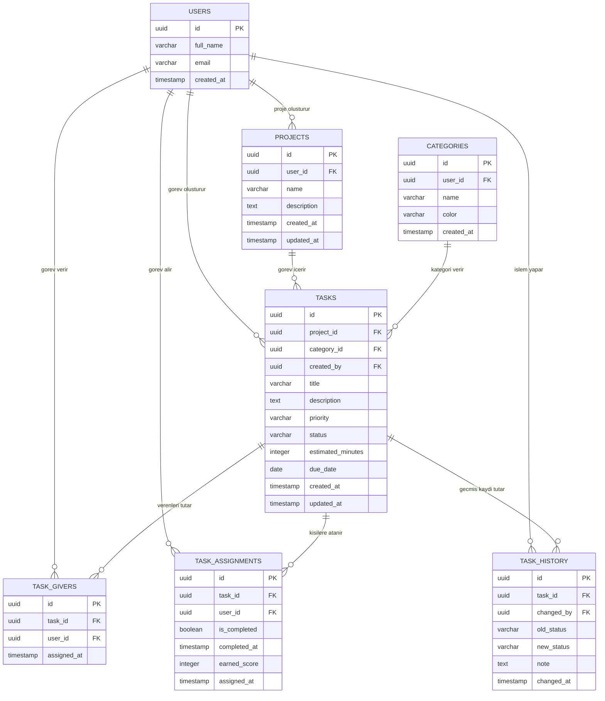
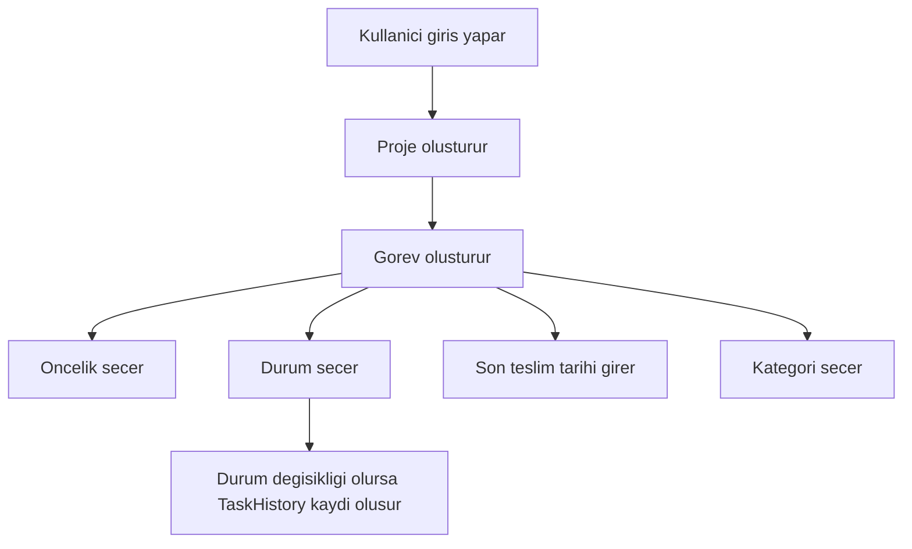

# ToDo+ Gorev Takip Sistemi - Veritabani Diyagramlari

Bu dosya, ToDo+ projesi icin Supabase/PostgreSQL uzerinde kurulacak temel veri yapisini gosterir.

## 1. ER Diyagrami



## 2. Tablo Aciklamalari

### Users

Kullanicilari tutar. Supabase Auth zaten kullanici girisini yonetecegi icin bu tablo, kullaniciya ait profil bilgilerini saklamak icin kullanilir.

Alanlar:

- `id`: kullanicinin benzersiz kimligi
- `full_name`: ad soyad
- `email`: kullanici e-posta adresi
- `created_at`: kayit tarihi

### Projects

Kullanicilarin olusturdugu projeleri tutar. Her kullanicinin birden fazla projesi olabilir.

Alanlar:

- `id`: projenin benzersiz kimligi
- `user_id`: projeyi olusturan kullanici
- `name`: proje adi
- `description`: proje aciklamasi
- `created_at`: olusturulma tarihi
- `updated_at`: son guncellenme tarihi

### Categories

Gorevleri gruplamak icin kullanilir. Ornek kategoriler: okul, is, kisisel, acil.

Alanlar:

- `id`: kategorinin benzersiz kimligi
- `user_id`: kategoriyi olusturan kullanici
- `name`: kategori adi
- `color`: arayuzde kullanilacak kategori rengi
- `created_at`: olusturulma tarihi

### Tasks

Sistemin ana tablosudur. Gorev bilgileri burada tutulur.

Alanlar:

- `id`: gorevin benzersiz kimligi
- `project_id`: gorevin bagli oldugu proje
- `category_id`: gorevin kategorisi
- `created_by`: gorevi olusturan kullanici
- `title`: gorev basligi
- `description`: gorev aciklamasi
- `priority`: gorev onceligi, `dusuk`, `orta`, `yuksek`
- `status`: gorev durumu, `bekliyor`, `devam_ediyor`, `tamamlandi`
- `estimated_minutes`: tahmini gorev suresi
- `due_date`: son teslim tarihi
- `created_at`: olusturulma tarihi
- `updated_at`: son guncellenme tarihi

### TaskAssignments

Gorevlerin hangi kullaniciya veya kullanicilara atandigini, yani gorevi kimin yapacagini tutar. Basari orani ve basari puani bu tablo uzerinden hesaplanir.

Alanlar:

- `id`: atama kaydinin benzersiz kimligi
- `task_id`: atanmis gorev
- `user_id`: gorevin atandigi kullanici
- `is_completed`: kullanicinin bu gorevi tamamlayip tamamlamadigi
- `completed_at`: tamamlama tarihi
- `earned_score`: gorevden kazanilan puan
- `assigned_at`: gorevin kullaniciya atanma tarihi

### TaskGivers

Gorevi veren kisi veya kisileri tutar. Bir gorev birden fazla kisi tarafindan verilebilir. Bu yapi okul, bolum veya ekip gibi ortamlarda birden fazla yetkilinin ayni gorevi tanimlayabilmesi icin kullanilir.

Alanlar:

- `id`: gorev veren kaydinin benzersiz kimligi
- `task_id`: hangi goreve ait oldugu
- `user_id`: gorevi veren kullanici
- `assigned_at`: gorev verme kaydinin tarihi

### TaskHistory

Gorevlerde yapilan durum degisikliklerini veya onemli islemleri kaydeder. Boylece bir gorevin gecmisi takip edilebilir.

Alanlar:

- `id`: gecmis kaydinin benzersiz kimligi
- `task_id`: hangi goreve ait oldugu
- `changed_by`: islemi yapan kullanici
- `old_status`: onceki durum
- `new_status`: yeni durum
- `note`: degisiklik notu
- `changed_at`: degisiklik tarihi

## 3. Iliski Ozeti

- Bir kullanici birden fazla proje olusturabilir.
- Bir proje birden fazla gorev icerebilir.
- Bir kullanici birden fazla gorev olusturabilir.
- Bir gorev bir veya birden fazla kisi tarafindan verilebilir.
- Bir gorev bir veya birden fazla kullaniciya atanabilir.
- Bir kullanicinin basari orani TaskAssignments tablosundan hesaplanir.
- Bir kategori birden fazla goreve atanabilir.
- Bir gorevin birden fazla gecmis kaydi olabilir.
- TaskHistory tablosu, gorev durumunun nasil degistigini takip etmek icin kullanilir.

## 4. Veri Tipleri ve Kurallar



Temel kurallar:

- `priority` sadece `dusuk`, `orta`, `yuksek` degerlerini alabilir.
- `status` sadece `bekliyor`, `devam_ediyor`, `tamamlandi` degerlerini alabilir.
- Her gorev mutlaka bir projeye bagli olmalidir.
- Her proje mutlaka bir kullaniciya bagli olmalidir.
- `due_date` bos birakilabilir, ama girildiyse son teslim tarihi olarak kullanilir.

## 5. Basari Orani ve Basari Katsayisi

Gorevi yapan kisilerin basari orani istatistik ekraninda gosterilir. Basari orani sadece tamamlanan gorev sayisina gore degil, gorevin onemine gore de hesaplanir.

Oncelik katsayilari:

- `dusuk`: 1 puan
- `orta`: 2 puan
- `yuksek`: 3 puan

Ornek hesaplama:

```text
basari_puani = tamamlanan_gorevlerin_oncelik_puanlari_toplami
toplam_puan = atanmis_tum_gorevlerin_oncelik_puanlari_toplami
basari_orani = basari_puani / toplam_puan * 100
```

Ornek:

Bir kullaniciya 3 gorev atanmis olsun:

- 1 yuksek oncelikli gorev = 3 puan
- 1 orta oncelikli gorev = 2 puan
- 1 dusuk oncelikli gorev = 1 puan

Toplam hedef puan `6` olur. Kullanici yuksek ve dusuk oncelikli gorevi tamamlarsa `4` puan kazanir.

```text
basari_orani = 4 / 6 * 100 = %66.6
```

Bu yontem sayesinde yuksek oncelikli gorevleri tamamlayan kullanicinin basari orani daha fazla artar.

## 6. Kisa Sunum Metni

Bu projede kullanicilar sisteme giris yaparak kendi projelerini olusturur. Her projenin altinda gorevler bulunur. Gorevlerin oncelik, durum, sure, kategori ve son teslim tarihi bilgileri tutulur. Kullanicilar gorevleri arayabilir, filtreleyebilir ve istatistik ekraninda tamamlanan veya devam eden gorevleri gorebilir. TaskHistory tablosu sayesinde gorevlerin durum degisiklikleri kayit altina alinir.
